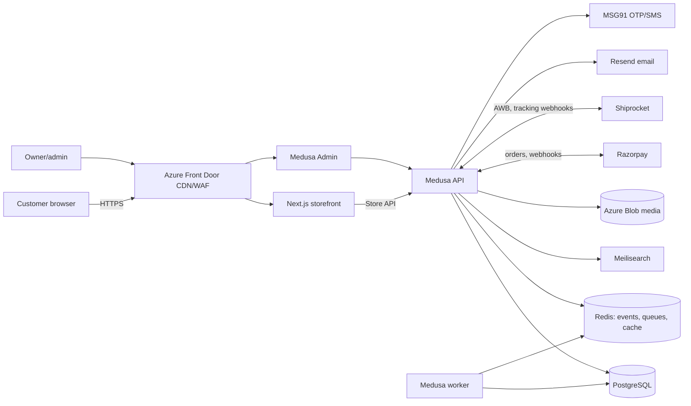

# Architecture

| Service                         | Local port          |
| ------------------------------- | ------------------- |
| Storefront                      | 8000                |
| Medusa API / Admin              | 9000 / 9000/app     |
| Postgres / Redis                | 5432 / 6379         |
| Meilisearch / Azurite / Mailpit | 7700 / 10000 / 8025 |

Principles: Medusa owns catalog, cart, order, payment, fulfillment; we extend it with modules in `apps/backend/src/modules`. The server computes every amount. Webhooks are signature-verified and idempotent. Business rules (shipping, COD, GST bands, returns) are admin config, not code constants.
